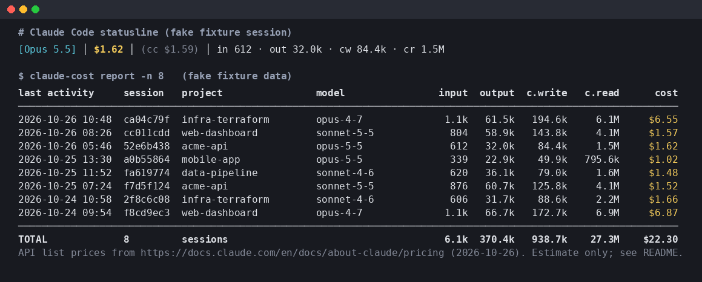
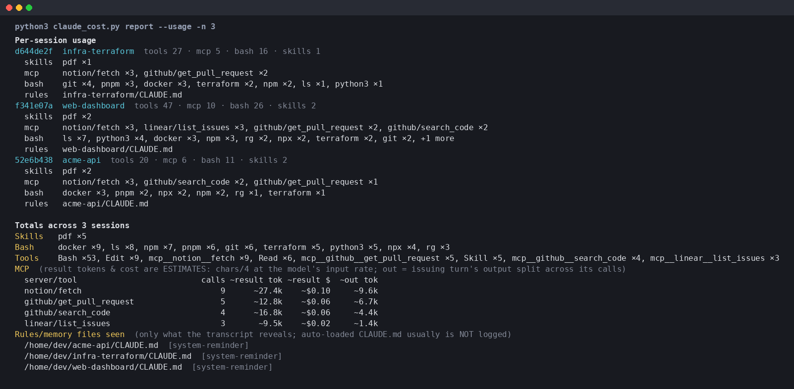
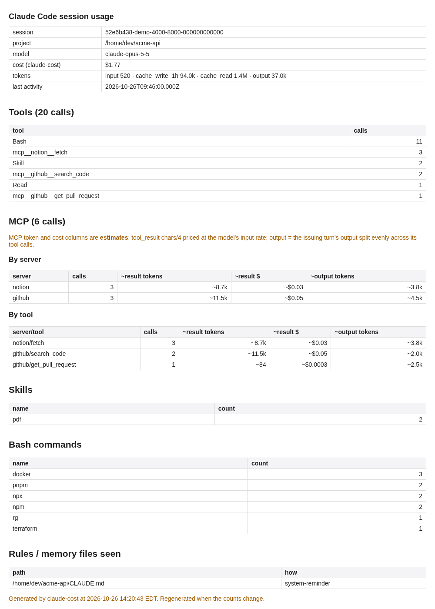

# claude-session-cost

See what each Claude Code session costs: a running per-session dollar figure in Claude Code's **statusline**, plus a **CLI report** of past sessions. One Python file, standard library only (Python 3.8+), no secrets, nothing sent anywhere.



*(The screenshot uses generated fake fixtures, not real usage.)*

## What it shows

**Statusline** (updates after every assistant message):

```
[Opus 5.5] │ $1.77 │ (cc $1.59) │ in 520 · out 37.0k · cw 94.0k · cr 1.4M │ tools 20 · mcp 6
```

| Part | Meaning |
| --- | --- |
| `[Opus 5.5]` | current model (`model.display_name`) |
| `$1.62` | session cost **computed by this tool** from the transcript |
| `(cc $1.59)` | Claude Code's own `cost.total_cost_usd` estimate, shown as a cross-check |
| `in / out / cw / cr` | uncached input, output, cache-write (5m + 1h), cache-read tokens for the session |
| `tools N · mcp M` | (dim) tool calls this session, of which MCP calls. Clickable (OSC 8) to a per-session HTML page, see below. `report --usage` has the cross-session breakdown |
| `?unpriced model` | (red) a model in the transcript isn't in the pricing table, so its tokens aren't counted |

**Report** (`claude-cost report`): one row per session (most recent first), with last activity (local time), short session id, project, main model, token columns and cost, plus a total row. Options:

```
claude_cost.py report            # last 10 sessions
claude_cost.py report -n 0       # all sessions
claude_cost.py report --today    # usage since local midnight
claude_cost.py report --days 7 -n 0
claude_cost.py report --usage    # skills, slash commands, MCP, Bash commands, rules files: per session + totals
claude_cost.py report --json     # machine-readable: {"sessions": [...], "totals": {...}}, each with "usage"
claude_cost.py pricing           # print the active pricing table
```

**Usage view** (`report --usage`), rendered from fake fixture data:



> **JSON shape changed in v0.2:** `report --json` used to print a bare list of sessions. It now prints `{"sessions": [...], "totals": {"cost_usd", "usage"}}`.

## What's measured vs estimated vs not detectable

| Category | Measured (exact, from the transcript) | Estimated | Not detectable |
| --- | --- | --- | --- |
| **Skills** | `Skill` tool calls, counted by `input.skill`. Slash commands from `<command-name>/x</command-name>` markers are listed separately. | none | Skills whose instructions were loaded without a `Skill` tool call. A slash command that maps to a skill is counted as a slash command, not as a skill. |
| **MCP** | Calls per `server/tool`, parsed from `mcp__<server>__<tool>` tool names and deduped by tool-use id. | `~result tok` = tool_result characters ÷ 4 (images count as 1,600). `~result $` = those tokens × the model's base input rate. `~out tok` = the issuing response's output tokens split evenly across its tool calls. | Real per-tool token counts: the API bills per response, not per tool. Re-reads of the result on later turns (cache reads) and MCP tool *definitions* in the system prompt are also not attributed. |
| **Rules / memory** | Files that show up in the transcript: `attachment` entries (e.g. nested memory), `Contents of …CLAUDE.md` system reminders, Read/Edit/Write on `CLAUDE.md`, `CLAUDE.local.md`, `AGENTS.md`, `.claude/rules/`, `.claude/memory/` or `memory/*.md`, and `@file.md` mentions in prompts. The report lists *how* each was seen. | none | **Auto-loaded CLAUDE.md files (user, project, enterprise) are usually injected into the system prompt and NOT written to the transcript**, so a missing entry does *not* mean the file wasn't used. Imports inside CLAUDE.md files are not detectable either, and nothing is counted per use. |
| **Bash** | Base command per segment of `&&`, `\|\|`, `;`, `\|` and newlines (quote-aware). Skipped: leading `VAR=…` assignments, wrappers (`sudo`, `env`, `time`, `nohup`, `nice`, `timeout`, `xargs`, `exec`, `command`, `stdbuf`) and their flags, and `cd`/`pushd`/`export`/`source`. Paths are reduced to the basename. | none | Commands inside `bash -c "…"`, `$(…)`, scripts, functions and aliases. Here-docs and complex shell syntax are parsed best-effort. |
| **All tools** | Count per tool name (`Read`, `Edit`, `Task`, …). | none | Calls made by subagents whose transcripts aren't on disk. |

## Clickable `tools N` / `mcp M`

Every status-line refresh writes a per-session page, `~/.claude/claude-cost/<session-id>.html` (plus a `.md` twin and a `last-session` pointer). The page lists each tool and each MCP server and server/tool with call counts, estimated result tokens, estimated cost and estimated output tokens. The status line wraps `tools N` and `mcp M` in [OSC 8](https://gist.github.com/egmontkob/eb114294efbcd5adb1944c9f3cb5feda) hyperlinks to `file:///…/<session-id>.html#tools` and `#mcp`. The page is rewritten only when the counts or cost change, so a refresh costs a hash comparison.



| Setting | Effect |
|---|---|
| `CLAUDE_COST_DIR=/path` or `statusline --usage-dir /path` | where pages go (default `~/.claude/claude-cost`, or `$CLAUDE_CONFIG_DIR/claude-cost`) |
| `CLAUDE_COST_LINKS=0` or `statusline --no-links` | plain text, and no page is written |
| `TERM_PROGRAM=Apple_Terminal` | links are turned off automatically (Terminal.app doesn't implement OSC 8) |

**Fallback when clicking doesn't work:** `python3 ~/.claude/claude_cost.py usage --open` regenerates the page for the most recently active session, prints its path and opens it in your browser. Other forms: `usage <session-id-prefix>` picks a session, `usage --md` prints the markdown path, and from inside Claude Code you can run `! python3 ~/.claude/claude_cost.py usage --open`.

### Will the link be clickable? (checked 2026-10-26)

Claude Code passes OSC 8 links from a statusLine command through, "(Cmd+click on macOS, Ctrl+click on Windows/Linux)", in terminals it detects as hyperlink-capable ([statusline docs](https://code.claude.com/docs/en/statusline)). If its detection says no, the escape is dropped. This happens with a generic `TERM` and no `TERM_PROGRAM`, over SSH, or under tmux. The documented override is `FORCE_HYPERLINK=1` ([anthropics/claude-code#70161](https://github.com/anthropics/claude-code/issues/70161), maintainer reply 2026-08-15). Put it in the `env` block of settings.json:

```json
{ "env": { "FORCE_HYPERLINK": "1" },
  "statusLine": { "type": "command", "command": "python3 ~/.claude/claude_cost.py statusline" } }
```

`FORCE_HYPERLINK` is parsed as a number, so set `1` to turn links on or `0` to turn them off. The values `false` and `off` do **not** turn links off ([reference](https://claude-code-log.com/reference/settings/force-hyperlink)).

| Terminal (macOS) | OSC 8 | Click | Notes / source |
|---|---|---|---|
| iTerm2 3.1+ | yes | ⌘-click | named as supported in the Claude Code statusline docs; [OSC8-Adoption](https://github.com/Alhadis/OSC8-Adoption) |
| Ghostty | yes | ⌘-click (⌘⇧-click while an app captures the mouse, e.g. Claude Code fullscreen) | links were dead until `FORCE_HYPERLINK=1` ([#70161](https://github.com/anthropics/claude-code/issues/70161)); host-qualified `file://host/…` URLs are blocked, so we emit `file:///…` ([ghostty#14368](https://github.com/ghostty-org/ghostty/discussions/14368), [ghostty#13060](https://github.com/ghostty-org/ghostty/discussions/13060)) |
| VS Code / Cursor terminal (1.72+) | yes | ⌘-click | [OSC8-Adoption](https://github.com/Alhadis/OSC8-Adoption); `file://` links can misbehave in remote (SSH/WSL/container) workspaces ([std-osc8 notes](https://github.com/spencerbeggs/std-osc8/blob/main/docs/terminals.md)) |
| Warp | unclear | ⌘-click | Warp docs say ⌘-click opens links, including `file://` ([docs](https://docs.warp.dev/terminal/more-features/files-and-links)), but a Warp engineer said in 2026-07 that OSC 8 clicking was still behind an internal flag ([warp#13965](https://github.com/warpdotdev/warp/issues/13965)). Use `usage --open` if it doesn't work |
| Terminal.app | **no** | — | "Terminal.app does not support clickable links" (Claude Code statusline docs); prints the escape as garbage ([claude-code#90698](https://github.com/anthropics/claude-code/issues/90698)). We turn links off when `TERM_PROGRAM=Apple_Terminal` |
| WezTerm, Kitty | yes | ⌘-click | statusline docs; WezTerm needed `FORCE_HYPERLINK=1` in #70161 |

**tmux / SSH:** tmux strips OSC 8 unless you add `set -as terminal-features '*:hyperlinks'` (tmux 3.4+), and you need `FORCE_HYPERLINK=1` as well ([#45173](https://github.com/anthropics/claude-code/issues/45173), [#37216](https://github.com/anthropics/claude-code/issues/37216)). Over SSH the `file://` path points at the remote machine, so open the page there with `usage --open` or copy the `.md` file.

**Subagents:** while the main session waits on background subagents, Claude Code doesn't re-run the status line. Add `"refreshInterval": 5` to the `statusLine` block to keep our cost and the page current.

## Install (one command)

```bash
mkdir -p ~/.claude && curl -fsSL https://raw.githubusercontent.com/TangentialSolutions/claude-session-cost/main/claude_cost.py -o ~/.claude/claude_cost.py && chmod +x ~/.claude/claude_cost.py
```

(or clone the repo and `cp claude_cost.py ~/.claude/`). Then add to `~/.claude/settings.json`:

```json
{
  "statusLine": {
    "type": "command",
    "command": "python3 ~/.claude/claude_cost.py statusline"
  }
}
```

Claude Code reloads settings automatically. For the report, optionally `alias claude-cost='python3 ~/.claude/claude_cost.py'`. Windows: use forward slashes in the command path (e.g. `python C:/Users/you/.claude/claude_cost.py statusline`). Set `NO_COLOR=1` to disable ANSI colors.

## Update (no clone needed)

```bash
curl -fsSL https://raw.githubusercontent.com/TangentialSolutions/claude-session-cost/main/update.sh | bash
```

Or, from an existing install of 0.4.0 or later:

```bash
python3 ~/.claude/claude_cost.py update                # latest main
python3 ~/.claude/claude_cost.py update --ref v0.4.0   # a tag, branch or commit sha
```

Both forms do the same steps:
1. Download `claude_cost.py` to a temp file next to the install.
2. Verify it: the download is non-empty, `python3 -m py_compile` passes, and `--version` runs.
3. Back up the current file to `~/.claude/claude_cost.py.bak-YYYYmmdd-HHMMSS`, keeping the newest 3 backups.
4. Replace the file with an atomic rename and print `old -> new` versions.

If the file is unchanged, they print `already up to date` and change nothing. They never touch `settings.json`, `claude-cost-pricing.json` or `~/.claude/claude-cost/`.

| Option | Script form | Subcommand form |
|---|---|---|
| Pick a release | `curl … \| bash -s -- --ref <tag/sha>` | `update --ref <tag/sha>` |
| Install somewhere other than `~/.claude` | `CLAUDE_COST_HOME=/path` (or `--home /path`) | `CLAUDE_COST_HOME=/path` (or `--home /path`) |
| Download from a mirror or local file | `CLAUDE_COST_UPDATE_URL=<full url>` (curl accepts `file://`) | `CLAUDE_COST_UPDATE_URL=<full url>` |

`update.sh` needs only bash 3.2 or later, BSD or GNU tools, curl and python3. It runs with `set -euo pipefail` and passes shellcheck. Check your installed version with `python3 ~/.claude/claude_cost.py --version`. To roll back, run `cp ~/.claude/claude_cost.py.bak-<stamp> ~/.claude/claude_cost.py`.

## How cost is computed

**Data source.** Claude Code pipes a JSON object to the statusline command on stdin ([docs](https://code.claude.com/docs/en/statusline)); this tool uses `session_id`, `transcript_path`, `model.display_name` and `cost.total_cost_usd`. It then reads the session transcript, a JSONL file under `~/.claude/projects/<encoded-project-path>/<session_id>.jsonl` (plus any subagent transcripts in `<session_id>/subagents/*.jsonl`). The report scans every `*.jsonl` under `~/.claude/projects` (or `$CLAUDE_CONFIG_DIR/projects`, or `--dir`).

Each `"type": "assistant"` line carries the raw API `message.usage`:

```json
{"type":"assistant","sessionId":"…","requestId":"req_…","timestamp":"…","isSidechain":false,
 "message":{"id":"msg_…","model":"claude-opus-4-5-20251101","usage":{
   "input_tokens":1000,"output_tokens":500,
   "cache_creation_input_tokens":20000,"cache_read_input_tokens":0,
   "cache_creation":{"ephemeral_5m_input_tokens":0,"ephemeral_1h_input_tokens":20000},
   "server_tool_use":{"web_search_requests":0}}}}
```

**Dedupe.** Claude Code writes one transcript line per content block (thinking, text, tool_use) of a streamed response, and each repeats the same `usage`. Lines are deduped by `(message.id, requestId)` (falling back to the line `uuid`), keeping the copy with the largest `output_tokens`. `<synthetic>` messages (local errors) are ignored, and malformed/partial lines are skipped.

**Pricing table.** `PRICING` at the top of `claude_cost.py`, in USD per million tokens, copied from **https://docs.claude.com/en/docs/about-claude/pricing on 2026-10-26**:

| Model | Input | 5m cache write | 1h cache write | Cache read | Output |
| --- | --- | --- | --- | --- | --- |
| Fable 5.1 / Mythos 5.1 | 10 | 12.50 | 20 | 0.25 | 50 |
| Fable 5 / Mythos 5 | 10 | 12.50 | 20 | 1.00 | 50 |
| Opus 5.5 | 4 | 5 | 8 | 0.20 | 20 |
| Opus 5 / 4.8 / 4.7 / 4.6 / 4.5 | 5 | 6.25 | 10 | 0.50 | 25 |
| Opus 4.1 / 4 | 15 | 18.75 | 30 | 1.50 | 75 |
| Sonnet 5.5 | 2 | 2.50 | 4 | 0.10 | 10 |
| Sonnet 5 | 2 | 2.50 | 4 | 0.20 | 10 |
| Sonnet 4.6 / 4.5 / 4 | 3 | 3.75 | 6 | 0.30 | 15 |
| Haiku 5.5 (prompt ≤ 100k / > 100k) | 0.10 / 0.50 | 0.125 / 0.625 | 0.20 / 1 | 0.01 / 0.05 | 0.50 / 2.50 |
| Haiku 4.5 | 1 | 1.25 | 2 | 0.10 | 5 |
| Haiku 3.5 | 0.80 | 1 | 1.60 | 0.08 | 4 |

Also applied: web search at $10 / 1,000 searches (`server_tool_use.web_search_requests`), Haiku 5.5's long-prompt tier per request, and Opus fast-mode input/output rates when `usage.speed == "fast"`. Sonnet 4 / 4.5 prompts over 200k tokens (only possible with the `[1m]` 1M-context beta) are billed at $6 input, $22.50 output, and 2× cache rates.

Model ids are normalized (`claude-opus-4-5-20251101[1m]`, `us.anthropic.claude-sonnet-4-5-…-v1:0`, `claude-3-5-haiku-…` → `opus-4-5`, `sonnet-4-5`, `haiku-3-5`) and matched exactly or by longest prefix. **Unknown models** are not guessed: their tokens are still counted, but the cost is excluded and flagged (`?unpriced model` / `*`).

**Overriding prices.** Put a JSON file at `~/.claude/claude-cost-pricing.json`, or point `CLAUDE_COST_PRICING` at one. Entries are merged over the built-ins, and keys may be full model ids:

```json
{ "claude-opus-5-5": {"input": 4, "cache_write_5m": 5, "cache_write_1h": 8, "cache_read": 0.2, "output": 20},
  "my-proxy-model": {"input": 1, "cache_write_5m": 1.25, "cache_write_1h": 2, "cache_read": 0.1, "output": 5} }
```

**Cache tokens.** `input_tokens` is only the *uncached* input. Cache writes (`cache_creation_input_tokens`) are split into 5-minute and 1-hour writes using `usage.cache_creation.ephemeral_5m_input_tokens` / `ephemeral_1h_input_tokens`. Any write not covered by that split (older transcripts) is priced as a 5-minute write, the API default, so if those writes were really 1-hour this **under**-estimates. Cache reads (`cache_read_input_tokens`) use the model's cache-hit rate.

**Cross-check.** Claude Code's `cost.total_cost_usd` is computed client-side at list price, and it resets on `/clear`. It's shown in parentheses so you can spot drift. Small differences are normal; large ones usually mean a pricing table is stale.

## Why our number differs from `cc`

`cc` is Claude Code's `cost.total_cost_usd`. The docs describe it as "computed client-side at list price unless a `modelPricing` table is in effect", and say it "accumulates the estimated cost of all API calls in the current session". We rebuild our number from the transcript files. We investigated one report of **$3.71 vs cc $4.46** on a Sonnet session with 2 running subagents, and reproduced it with the `tests/fixtures/gap` fixture. These were the causes, roughly in order of size:

1. **Subagent cost dropped from the status line (bug, fixed in this version).** The status line kept only the entry for the parent `session_id`. A subagent file with no `sessionId` on its lines ended up under a different id and was silently dropped. Subagent logs written by older Claude Code versions, as sibling `agent-*.jsonl` files in the project dir, were never read at all. Now every file under `<sid>/subagents/` is attributed to the parent, and sibling `agent-*.jsonl` files whose `sessionId` matches are included.
2. **Long-context pricing on Sonnet 4 / 4.5 with `[1m]` (bug, fixed).** The 1M-context beta charges $6 input and $22.50 output per MTok, with cache rates doubled, once a prompt (input plus cache reads and writes) exceeds 200k tokens ([Anthropic](https://claude.com/blog/1m-context)). We stripped `[1m]` and priced everything at the base rate. Claude 4.6 and later have no premium.
3. **1-hour cache writes priced as 5-minute writes (fixed when detectable).** If a transcript has `cache_creation_input_tokens` without the 5m/1h split, we used to price it all at 1.25×. Now the status line uses `prompt_cache.ttl` from Claude Code's statusLine JSON. You can also set `CLAUDE_COST_CACHE_TTL=1h` for `report` and `usage`.
4. **Calls that never reach the transcript (not fixable, documented).** `cc` includes every API call the client makes, such as auto-compaction summaries, title/topic generation, and other background calls. These aren't logged with usage, and on a long session a single compaction re-reads the whole context.
5. **Timing.** A subagent's in-flight response is logged only once it finishes, and the status line doesn't refresh while the main session is idle. Set `refreshInterval`.

We also checked these, and they were **not** the cause:
- Web search is already billed at $10/1k.
- Deduplication on `(message.id, requestId)` only collapses the repeated lines of one response. A `/btw` sidechain file that re-logs parent turns now keeps the original main-session attribution instead of moving that cost into `sidechain_cost`.
- Fast mode applies only to Opus.

On the fixture, the old code showed **$0.46** in the status line, against $0.83 now with 5m caching and $0.97 with a 1h TTL. That is the same direction and order of size as the reported gap. Some difference from `cc` will remain because of item 4.

## Known accuracy limits

- **Subscription vs API billing.** On Claude Pro/Max/Team/Enterprise seats you don't pay per token. The number shown is the *API-equivalent list price*, not your bill. Negotiated discounts, Batch, Bedrock/Vertex/Foundry pricing, and the 1.1× US data-residency multiplier (`inference_geo: "us"`) aren't modeled. Override the table to approximate them.
- **Subagents and sidechains.** Task subagent usage is included when it's in the session transcript (`isSidechain: true`) or in `<session>/subagents/*.jsonl`. `report --json` breaks it out as `sidechain_cost_usd`. Older sibling `agent-*.jsonl` logs are matched by `sessionId`. Claude Code's own figure may include or exclude these differently.
- **Pricing drift.** Prices are a snapshot from 2026-10-26. Check the source page and update `PRICING` (or use the override file) when Anthropic changes rates or ships new models.
- **Tokens missing from logs.** Only what Claude Code writes to the transcript is counted. Interrupted or failed requests, background calls (e.g. title generation, compaction summaries or classifier calls that aren't logged), and deleted or rotated transcripts (Claude Code prunes old transcripts after `cleanupPeriodDays`, 30 by default) aren't counted. `/clear` starts a new session id. A resumed session that forks into a new file is reported as a separate session.
- **Tool and other fees.** Web search is priced at $10/1k from `server_tool_use`. Code-execution container hours, Managed Agents runtime and any other non-token fees are not included.
- **Rounding.** Costs are computed per API response and summed. Your invoice may round differently.

## Development

```bash
python3 tests/make_fixtures.py        # regenerate fake fixtures
python3 -m unittest discover -s tests -v   # includes update.sh tests (fake HOME, file:// URL)
shellcheck update.sh
python3 docs/render.py …              # screenshot helper (needs Pillow; dev only)
```

## License

MIT, see [LICENSE](LICENSE).
